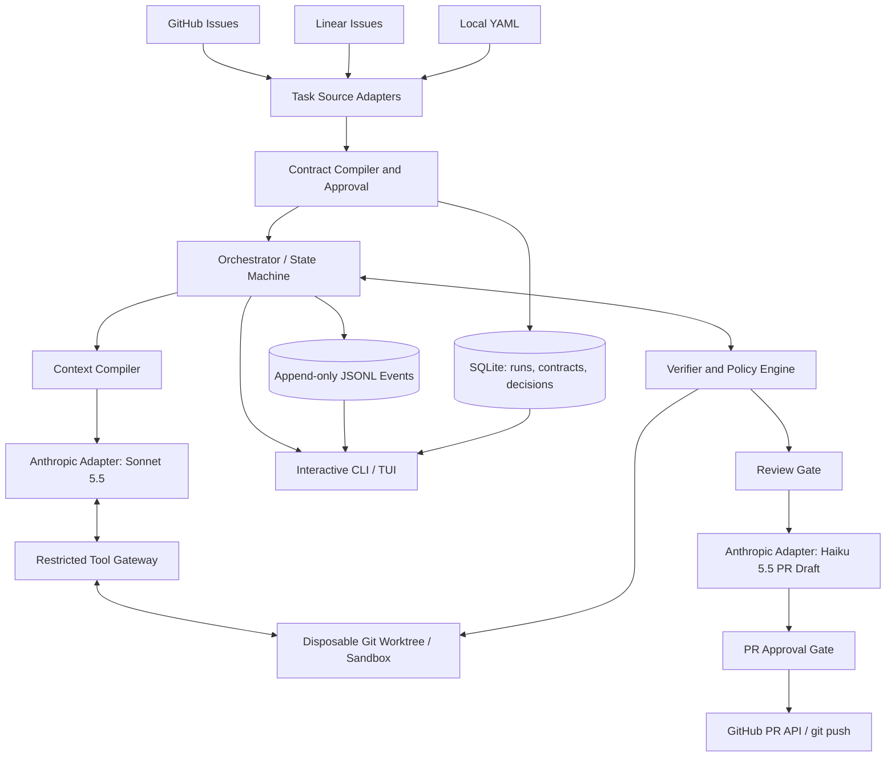
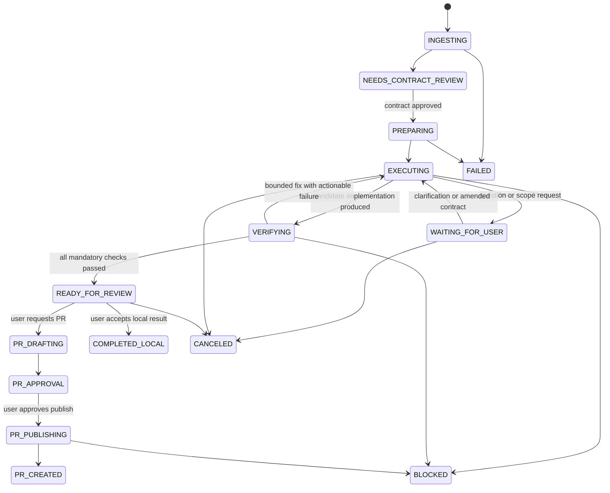

# Aperture Harness — System Design Specification

**Status:** Proposed / MVP design  
**Version:** 0.2 (Amendment A1, §21)  
**Date:** 2026-11-04  
**Primary implementation language:** TypeScript (Node.js)  
**Interface:** Interactive terminal UI and noninteractive CLI  
**Primary executor model:** `claude-sonnet-5-5`  
**Pull request drafting model:** `claude-haiku-5-5`  
**Sources:** GitHub Issues, Linear issues, and local YAML contracts

## 1. Executive summary

Aperture Harness is a **budget-controlled, contract-driven coding execution system** for small, atomic software tasks (typically changes to 3–4 files). A stronger planning workflow produces an explicit task contract; the harness runs a configured coding model against that contract, enforces its permissions outside the model, streams an auditable record of actions, asks users for clarifications or approvals, verifies the result, and can optionally create a GitHub pull request after explicit approval.

**Central invariant:** The *task* owns scope, acceptance criteria, state, budget, and completion. The model is a replaceable execution worker. No instruction in an issue, repository file, tool response, or model output can modify the approved task contract or grant additional permissions.

The MVP uses **Claude Sonnet 5.5 for implementation** and **Claude Haiku 5.5 for PR title/body drafting**, with separate per-stage budgets. Prompt caching is enabled for stable prefixes and accounted for using actual API usage. Additional cheaper coding models can be introduced behind a provider interface without redesigning the harness.

## 2. Goals and non-goals

### Goals

1. Start from GitHub Issues (`owner/repo#123`), Linear issues (`ENG-123`), or local contract YAML.
2. Convert source tickets into **reviewable, versioned task contracts** with explicit requirements, file permissions, success criteria, and resource limits.
3. Execute with **Sonnet 5.5**, isolated from the user's working directory and subject to deterministic tool, path, command, and network policies.
4. Present **live progress**: stage, planned actions, emitted model text, tool arguments/results, file reads, proposed diffs, checks, retries, questions, approvals, token/cache usage, and spend.
5. Pause for missing product decisions or scope expansions, persist the answer, and resume without losing state.
6. Persist an append-only event log and recover from unexpected interruption without replaying unsafe mutations.
7. Verify completion with test results and requirement-to-evidence traceability; do not infer success from the model's own declaration.
8. Draft PR metadata with **Haiku 5.5**, request human approval, then create a GitHub PR via a narrowly scoped GitHub integration.
9. Maintain configurable per-ticket and per-stage budgets with pre-request estimates and enforced stop conditions.

### Non-goals for MVP

- A new foundation model, fully autonomous planning, or a replacement for Claude Code/Codex.
- Multi-agent swarms, distributed workers, cloud scheduling, or a web dashboard.
- Automatically merging PRs, closing tickets, deploying code, or modifying project dependencies without explicit approval.
- Guarantees that semantic changes are correct merely because file policy and tests pass.
- Exposing hidden model chain-of-thought. The TUI displays *observable outputs and tool activity* only.

## 3. Personas and primary workflow

**Primary user:** Individual developer with a fixed LLM budget, an existing planning workflow, and mostly atomic tickets.

**Happy path:**

1. User runs `aperture run github:org/repo#142 --model claude-sonnet-5-5 --budget 0.50`.
2. Source adapter fetches issue title, body, relevant comments, labels, and GitHub metadata; no issue text is trusted as an instruction.
3. Contract compiler proposes requirements, allowed files, tests, and budget. User reviews/approves the contract. A preapproved local contract may skip this interactive gate.
4. Harness creates a clean, isolated Git worktree, snapshots revision and hashes, and compiles limited execution context.
5. Sonnet 5.5 performs bounded tool-driven implementation. All file writes are patch proposals through the policy gateway.
6. TUI streams persisted events, progress and cost. Ambiguities or permission requests pause the run.
7. Verifier checks all changed paths, targeted tests, typecheck, and explicit requirement evidence; blocked or unverified changes are visible.
8. User reviews the diff and accepts the result.
9. On `aperture pr create <run-id>`, Haiku 5.5 drafts a title, summary, test plan, and issue link using only verified artifacts. User approves title/body, branch push, and PR publication. Harness creates the PR using GitHub credentials.
10. Final report includes contract version, model IDs, exact changed files, checks, decisions, caching, cost, PR URL (if created), and remaining risks.

## 4. System context and architecture



### Component responsibilities

| Component | Responsibilities | Explicitly cannot do |
|---|---|---|
| Task source adapters | Fetch/normalize ticket and source metadata | Authorize tool permissions or change scope |
| Contract compiler | Extract requirements, suggest allowed paths/checks, hash approved contract | Execute code without approval |
| Orchestrator | Advance finite-state machine, route model calls, enforce budgets | Override policy due to model requests |
| Context compiler | Assemble stable and dynamic model context | Supply uncontrolled repository-wide dumps by default |
| Model adapter | Stream Anthropic messages, tool-use requests, usage | Write files or invoke arbitrary shell directly |
| Tool gateway | Validate typed tool inputs; authorize reads/patches/checks | Accept arbitrary command strings from model |
| Worktree sandbox | Isolate code and temporary artifacts | Access host secrets or unrestricted network |
| Verifier | Produce test/diff/requirement evidence | Mark semantic completion solely on model claim |
| Event store | Audit trail and replay projection | Store credentials in plaintext logs |
| PR publisher | Publish approved branch and PR using GitHub API | Merge automatically or alter unrelated repository resources |

**Trust boundary:** All model-facing content is untrusted (including fetched issue comments, source code, tool outputs, and GitHub PR templates). The approved contract and policy configuration come from trusted local state and must not be re-authored by the executor.

## 5. Proposed repository structure

```text
aperture-harness/
  apps/
    cli/                   # commands, Ink TUI, interaction prompts
  packages/
    core/                  # orchestration, state transitions, budgets
    contracts/             # Zod schemas, normalization, hashes
    sources/               # github, linear, yaml adapters
    models/                # Anthropic adapter, model routing, caching
    context/               # bounded context selection, stable prefixes
    gateway/               # typed tools, path/command authorization
    sandbox/               # worktrees, runtime isolation, checkpoints
    verifier/              # diff checks, lint, typecheck, tests
    events/                # JSONL emitter, projections
    storage/               # SQLite migrations, transactions
    pr/                    # Haiku 5.5 draft, PR approval, GitHub publish
  fixtures/
    sample-contract.yaml
    sample-issue.json
  tests/
    integration/
    adversarial/
    golden/
```

Suggested stack: Node.js LTS, TypeScript, Zod, `better-sqlite3` (or equivalent), official Anthropic SDK, `@octokit/rest` / GitHub App or `gh` integration, Linear GraphQL API, `simple-git` or direct argument-based git subprocesses, and Ink for TUI. Keep components interface-driven so each dependency can be replaced.

## 6. Contract format and authorization

The normalized source issue is *input data*, not the executable contract. Compilation produces a proposed contract; the operator approves it before any code modifications.

```yaml
apiVersion: aperture.dev/v1
kind: ExecutionContract
metadata:
  id: GH-142
  source:
    type: github
    repository: org/repo
    issueNumber: 142
  baselineRef: main
  title: Add optional session metadata
spec:
  goal: Accept and forward optional session metadata without changing existing behavior
  requirements:
    - id: R1
      text: Accept an optional metadata field in the endpoint
    - id: R2
      text: Forward metadata to the session manager
    - id: R3
      text: Preserve compatibility when omitted
  scope:
    writable:
      - src/api/session.ts
      - src/services/session-manager.ts
      - src/types/session.ts
      - src/api/session.test.ts
    readable:
      - src/api/**
      - src/services/**
      - src/types/**
    denied:
      - .env*
      - '**/secrets/**'
      - package.json
      - pnpm-lock.yaml
      - prisma/schema.prisma
  permissions:
    network: deny
    dependencies: deny
    shell: approved-checks-only
    issueWrites: deny
    pullRequestCreate: approval-required
  checks:
    - id: unit
      commandId: unit-session
      required: true
    - id: typecheck
      commandId: typecheck
      required: true
  limits:
    maxModelTurns: 12
    maxPatchAttempts: 8
    maxCostUsd: 0.50
    maxWallClockMinutes: 30
  models:
    implement: claude-sonnet-5-5
    prDraft: claude-haiku-5-5
  cache:
    enabled: true
    ttl: 5m
```

**Contract rules:**

- After approval, store immutable JSON serialization, SHA-256 digest, approver, timestamp, schema version, and source revision.
- Validate paths after normalization and symlink resolution; deny traversal (`../`), absolute paths, symlink escapes, protected directories, and case-folding collisions.
- Default deny when writable and denied patterns overlap. Restrict file writes physically through sandboxing as well as logical tool authorization.
- Changes to goal, requirements, allowed files, checks, or budgets require a **new contract revision with approval**. A clarification can append a scoped decision record, but cannot silently grant capabilities.
- Each patch must reference one or more requirement IDs. Traceability is useful, but an LLM-supplied justification is not proof of correctness.
- If the source issue is missing sufficient acceptance criteria, mark `NEEDS_CONTRACT_REVIEW` rather than invent details.

## 7. State machine



Terminal outcomes: `COMPLETED_LOCAL`, `PR_CREATED`, `BLOCKED`, `FAILED`, `CANCELED`. `READY_FOR_REVIEW` is *not* completed/merged. Retrying verification uses capped turns and budget; repeated identical failures are treated as stalled and stop execution.

**Crash recovery:** On resume, derive state from SQLite transactional checkpoints and JSONL events; inspect the current worktree against the last committed checkpoint. Never automatically replay a non-idempotent file patch, git push, or PR POST. Use per-operation IDs, persisted results, and remote lookup/idempotency checks before any retry.

## 8. Model and prompt caching design

### Routing

| Workload | Default model | Notes |
|---|---|---|
| Implementation and tool selection | `claude-sonnet-5-5` | Capped iterative execution; no unrestricted shell |
| PR title, body, test summary | `claude-haiku-5-5` | Only after verified, approved diff; output is untrusted draft |
| Contract drafting | Existing external planning workflow or optional Sonnet | User approves before implementation |
| Deterministic policy and test checks | No model | Never delegate hard authorization to a model |

### Prompt layout

1. Stable system instructions (role, tool semantics, refusal to expand scope).
2. Stable tool definitions and approved contract summary.
3. Stable relevant code/context snapshot and repository conventions.
4. Append-only dynamic execution messages, tool results, verification failures, and user decisions.

Start with Anthropic's **5-minute prompt caching**; use explicit cache breakpoints for stable prefixes or automatic caching if it is simpler and gives comparable hit rates. Ensure identical byte content and tool definitions within the reusable prefix. A cache does not persist the agent's task state; SQLite does. Never include secrets in cached prompts. Measure actual `input_tokens`, `output_tokens`, `cache_creation_input_tokens`, and `cache_read_input_tokens` separately.

### Prices at specification date (USD per million tokens)

| Model / tier | Input | Output | 5m cache write | 1h cache write | Cache read |
|---|---:|---:|---:|---:|---:|
| Sonnet 5.5 | $2.00 | $10.00 | $2.50 | $4.00 | $0.10 |
| Haiku 5.5 (prompts up to 100K tokens) | $0.10 | $0.50 | $0.125 | $0.20 | $0.01 |
| Haiku 5.5 (prompts over 100K tokens) | $0.50 | $2.50 | $0.625 | $1.00 | $0.05 |

Haiku's long-prompt pricing tier matters: keep PR drafting inputs concise (issue summary, diffstat, verified checks, relevant excerpts), ideally far below 100K tokens. Prices are configuration data; refresh before release and do not bake them into code. Anthropic model IDs are `claude-sonnet-5-5` and `claude-haiku-5-5`.

**Cost ledger formula:** Charge each response according to actual provider-reported usage and active pricing tier, including cache writes and reads, model-specific surcharges, and any billed tool services. `estimatedRemainingCost` is conservative. Since a hard dollar guarantee is difficult before an API response, enforce max output tokens, total-turn caps, preflight token estimates, and refusal to start requests that cannot fit a configured reserve; provider-side limits remain an additional safety net. Maintain separate `implementationBudgetUsd` and `prBudgetUsd` under a shared task budget.

## 9. Agent tools and hard boundaries

Expose a small typed tool protocol:

```ts
type ToolRequest =
  | { id: string; name: 'read_file'; input: { path: string; startLine?: number; endLine?: number } }
  | { id: string; name: 'search_code'; input: { pattern: string; within?: string[] } }
  | { id: string; name: 'propose_patch'; input: { path: string; unifiedDiff: string; requirementIds: string[] } }
  | { id: string; name: 'run_check'; input: { checkId: string } }
  | { id: string; name: 'ask_user'; input: { question: string; choices?: string[]; blocking: true } }
  | { id: string; name: 'request_scope_change'; input: { reason: string; additionalPaths: string[] } }
  | { id: string; name: 'report_blocked'; input: { reason: string; evidence?: string[] } };
```

**Gateway invariants:**

- Reject unsupported tools and malformed arguments before execution.
- `read_file` respects readable scope and size caps; `search_code` searches only approved roots with bounded output.
- `propose_patch` applies to a temporary copy or worktree only after path policy, patch context, allowed changes, and file type checks. It must not execute arbitrary instructions embedded in a patch.
- `run_check` takes a declared `checkId`, not a shell command supplied by the model. The runner maps IDs to fixed executable + argument arrays.
- All commands execute inside a sandbox with explicit working directory, timeout, resource limits, and minimal environment. No uncontrolled network; avoid running untrusted repo install scripts.
- Scope expansion pauses and requires approval of a new contract version. Reject unauthorized writes even if the model argues they are necessary.
- `ask_user` should include why the question blocks completion and the affected requirement IDs. Questions are persistent.

**Isolation:** A Git worktree alone does not protect the host filesystem. MVP must additionally use a sandbox boundary appropriate to the platform (container/VM or equivalent restricted process with access only to the worktree), no ambient cloud tokens, and no unrestricted network. If a secure sandbox is unavailable, fail closed for unattended execution and require an explicit reduced-security local mode.

## 10. Streaming CLI / TUI and interaction design

### Commands

```bash
aperture init
aperture run github:org/repo#142 --model claude-sonnet-5-5 --budget 0.50
aperture run linear:ENG-123 --cache 5m
aperture run ./tasks/ENG-123.yaml --no-interactive
aperture status <run-id>
aperture attach <run-id>
aperture logs <run-id> --format text|jsonl
aperture diff <run-id>
aperture usage <run-id>
aperture answer <run-id> <question-id>
aperture resume <run-id>
aperture cancel <run-id>
aperture review <run-id>
aperture pr draft <run-id> --model claude-haiku-5-5
aperture pr create <run-id>        # user approval required
```

### Views

- **Overview:** ticket goal, contract digest, progress checklist, current state, model, run ID, budget progress.
- **Activity:** timestamped text chunks and *observable* tool calls/results; filter by model, tool, policy, check, question, or error.
- **Diff:** per-file patch, line counts, requirement mappings, policy rejections, read-only review.
- **Checks:** unit tests, typecheck, lint, structured failure logs, requirement coverage.
- **Costs:** request-level input/output/cache write/cache read tokens and actual vs estimated spend, separated by coding and PR drafting.
- **Questions:** blocking prompts, explicit choices, free-form answer, approve/deny scope amendments, recorded rationale.

**TUI behavior:** Render streamed events without losing underlying durable event records; support verbose/compact mode, quiet noninteractive mode, event filtering, and an explicit `--show-model-text` option. Redact secrets and sensitive fields from logs by default. Never mislabel model-generated explanations as internal reasoning.

### Example live output

```text
$ aperture run github:org/repo#142 --budget 0.50
RUN  01J...    STATE EXECUTING       MODEL claude-sonnet-5-5
GOAL Add optional session metadata
[✓] Contract approved (v1)     [✓] Read 3 files
[✓] Patch session.ts (+18 -4) [>] Running unit-session
[!] Policy denied: attempted package.json modification
[?] Clarification: reject or ignore unknown metadata keys?
    1) Reject with 400     2) Ignore     3) Other
    > 1
Budget: $0.083 / $0.500    Cache reads: 42,000 tokens
```

Questions must not be silently answered based on model preference. If `--no-interactive` and no preauthorized answer exists, transition to `BLOCKED` and exit nonzero.

## 11. Data model and event protocol

### SQLite tables (minimum)

| Table | Key columns |
|---|---|
| `tasks` | `task_id`, `source_type`, `source_ref`, `repository`, `created_at` |
| `contracts` | `contract_id`, `task_id`, `version`, `canonical_json`, `sha256`, `approved_by`, `approved_at` |
| `runs` | `run_id`, `task_id`, `contract_id`, `state`, `model_id`, `worktree_path`, `baseline_sha`, `started_at`, `updated_at` |
| `events` | `run_id`, `sequence`, `event_id`, `type`, `payload_json`, `timestamp` |
| `decisions` | `decision_id`, `run_id`, `question_id`, `answer_json`, `actor`, `contract_version` |
| `model_usage` | `request_id`, `run_id`, `phase`, `model_id`, `input`, `output`, `cache_write`, `cache_read`, `cost_usd` |
| `checks` | `check_id`, `run_id`, `status`, `exit_code`, `artifact_path`, `started_at`, `finished_at` |
| `artifacts` | `artifact_id`, `run_id`, `type`, `path`, `sha256` |
| `pr_publications` | `run_id`, `repository`, `branch`, `head_sha`, `pr_number`, `pr_url`, `approved_at` |

Use WAL mode and transactions around state transitions. Event write + state checkpoint should be correlated by a monotonic sequence; on restart, reconcile missing JSONL projections from SQLite (or choose one authoritative append log and make the other a rebuildable projection). Avoid two independently authoritative stores.

### Event envelope

```json
{
  "schemaVersion": 1,
  "eventId": "evt_0042",
  "runId": "run_001",
  "sequence": 42,
  "timestamp": "2026-11-04T20:00:00.000Z",
  "type": "tool.patch.rejected",
  "payload": {
    "toolCallId": "call_17",
    "path": "package.json",
    "reasonCode": "PATH_NOT_WRITABLE",
    "requirementIds": ["R2"]
  }
}
```

Event names: `run.created`, `contract.proposed`, `contract.approved`, `state.changed`, `model.request.started`, `model.output.delta`, `model.usage.recorded`, `tool.requested`, `tool.approved`, `tool.rejected`, `tool.completed`, `question.asked`, `question.answered`, `verification.started`, `verification.completed`, `budget.warning`, `budget.exhausted`, `pr.draft.created`, `pr.approval.requested`, `pr.published`, `run.finished`.

Persist tool result hashes and bounded/redacted payloads, not full unfiltered secret-bearing streams. The event log can support timeline replay and a future UI without relying on terminal captures.

## 12. Verification and definition of done

### Verification pipeline

1. **Scope:** `git diff --name-status` against baseline; every change path authorized; no unexpected untracked files, symlinks, binary changes, permission changes, or dependency edits.
2. **Syntactic:** patch applies cleanly; formatting/lint as configured.
3. **Static:** typecheck and configured static analysis.
4. **Behavioral:** targeted tests defined in approved contract; test failures exposed verbatim within redaction limits.
5. **Requirements:** each acceptance criterion mapped to concrete file diff + test or explicit manual-review evidence; missing proof means `UNVERIFIED`.
6. **Human review:** final acceptance of diff and unresolved semantic risks. No automatic assumption that green tests equal correct product behavior.

**Results:** `PASS`, `FAIL`, `UNVERIFIED`, `SKIPPED_WITH_APPROVAL`, or `BLOCKED`. Every skipped required check needs a recorded authorized exception. Completion requires the approved policy's necessary checks to pass (or explicit exceptions) plus human acceptance.

Retries are limited by both number and cost. The harness feeds back specific failed-check diagnostics; it detects repeated unchanged failure signatures and halts rather than looping indefinitely.

## 13. Pull request creation with Haiku 5.5

PR creation is a **separate, explicit workflow**; Haiku drafts text, but never gets write credentials or direct GitHub mutation tools.

### Preconditions

- Run reached `READY_FOR_REVIEW` and required checks pass or have approved exceptions.
- User approved the implementation diff.
- Target GitHub repository and base branch are known; for a Linear-origin task, user must associate a GitHub repository.
- Worktree branch name, base SHA, and head SHA are pinned; no unexpected changes since review.
- PR budget remains available.

### Flow

1. `aperture pr draft <run-id>` creates a **small evidence packet**: approved title/requirements, changed-file summary, important diff hunks, checks and outcomes, exceptions, source links.
2. Invoke **`claude-haiku-5-5`**, with caching if worthwhile, to produce structured `{ title, summary, changes, testing, risks, issueReference }` fields. Never invent test results; include only verified evidence.
3. Validate draft length, required fields, links, and citations to the issue; redact secrets. Render draft in TUI for editing.
4. Show proposed Git branch, remote, target base, commits, PR title/body, and anticipated GitHub action. Explicitly request **Publish PR** approval.
5. Harness uses git/GitHub integration with narrow permission to create/push a branch and open a PR. Prefer a **draft PR** by default; no automatic merge.
6. Persist PR number/URL and publish event. On network retry, first query for existing PR by branch/head to prevent duplicates.
7. If checks or diff changed after review, invalidate PR approval and require re-review.

### Haiku PR draft prompt contract

```text
ROLE: Draft a factual GitHub pull request title and description.
INPUTS: Approved issue requirements, verified diff summary, actual checks,
        known limitations, source issue reference.
RULES: Do not claim a check ran unless verified; do not invent changes,
       benefits, or scope; return structured fields only.
OUTPUT: title, summary, changes[], testing[], risks[], issueReference.
```

The PR workflow has a configurable small separate cap (for example `$0.02`), but real spending is charged from usage, not assumed to fit the example value. If Haiku fails, the CLI falls back to a deterministic PR template and asks for manual editing instead of silently escalating models.

### GitHub permissions

Read: issue metadata and relevant repository data. Write (only on PR approval): contents to the designated branch and pull requests. Avoid broad personal access tokens in the model environment. If using `gh`, use a credential helper scoped to the publisher process, not the execution sandbox. Never post issue comments, modify labels, merge, or close issues in MVP.

## 14. Failure handling and threat model

| Failure / threat | Mitigation |
|---|---|
| Prompt injection in ticket/source | Treat as data; fixed trusted instructions; approved contract is authoritative |
| Agent invents work | Tool allowlist, required requirement IDs, diff traceability, human review |
| Path traversal or symlink escape | Canonical path checks, deny symlink writes, sandbox mount boundaries |
| Unrestricted shell or exfiltration | Approved command IDs; isolated runner; no network by default; no exposed credentials |
| Agent claims done prematurely | Independent checks and required acceptance-evidence gate |
| Tests are missing/insufficient | Mark unverified; require reviewer decision |
| Repeated ineffective retries | Failure-signature detection, max turns, patch caps, time/budget stop |
| Provider downtime/rate limit | Exponential backoff only for safe idempotent reads/model calls; persist state |
| Crash during patch | Atomic patch stage and worktree reconciliation; no blind replay |
| Crash during PR creation | Remote PR lookup before retry; persist branch/head and operation ID |
| Budget exceeded | Preflight estimate, token caps, per-stage ledger, stop before next request |
| Sensitive content in logs | Secret redaction, restricted file permissions, no raw auth headers |
| Repo test executes malicious code | Isolated resource-constrained sandbox with no secrets/network |
| Source ticket changes mid-run | Pin issue snapshot/revision; show drift and request amendment |

## 15. CLI configuration

```yaml
# ~/.config/aperture/config.yaml
providers:
  anthropic:
    apiKeyEnv: ANTHROPIC_API_KEY
models:
  implementation: claude-sonnet-5-5
  prDraft: claude-haiku-5-5
cache:
  enabled: true
  ttl: 5m
limits:
  maxCostPerRunUsd: 0.50
  maxPrDraftCostUsd: 0.02
  maxModelTurns: 12
  maxPatchAttempts: 8
runtime:
  isolation: required
  network: deny
  questionMode: interactive
storage:
  directory: ~/.local/share/aperture
pr:
  draftByDefault: true
  requireApproval: true
```

API keys must come from environment variables or OS keychain, not YAML values. Config schema validation should reject unknown privileged options and show effective policy before execution. Model names are provider-specific IDs and resolved through a central registry (pricing, capabilities, default token budgets).

## 16. Output artifacts

For each run, create a durable folder:

```text
runs/<run-id>/
  contract.v1.json
  source.snapshot.json
  events.jsonl
  usage.json
  proposed.patch
  verification.json
  report.md
  pr-draft.json         # only after draft
  pr-publication.json   # only after successful publish
```

The final report must identify run state; requirements matrix; baseline/head SHAs; file changes; actual checks, warnings and skipped checks; decisions; denied actions; models; token/cache breakdown; total actual cost; whether PR publication occurred; and the PR URL if available. A `report.md` is human-readable and `verification.json` is machine-readable.

## 17. MVP implementation plan

### Phase 1 — Contract and sandbox (first vertical slice)

- Implement contract schema/validation, local YAML task source, immutable approval, clean worktree and isolation.
- Implement `read_file`, `search_code`, `propose_patch`, and `run_check` with path and command policy.
- Implement SQLite checkpoint/event storage and basic CLI text stream.
- **Exit criterion:** an adversarial agent attempt to touch `package.json` is denied and logged, while permitted patch/check succeeds.

### Phase 2 — Sonnet execution and recovery

- Anthropic streaming adapter (`claude-sonnet-5-5`), tool loop, cache instrumentation, budget meter.
- Task state machine, pause/resume, persistent clarification and scope approval.
- Test and static check verification, requirement evidence, diff report.
- **Exit criterion:** interrupted work can resume without duplicate patch application; run stops at budget/iteration cap; verification determines readiness.

### Phase 3 — Ticket integrations and richer TUI

- GitHub Issue and Linear adapters, source pinning, interactive contract approval.
- Ink panels for progress, activity, questions, diff, checks and costs.
- **Exit criterion:** same normalized task/contract workflow for GitHub, Linear and YAML.

### Phase 4 — Haiku PR publishing

- Haiku 5.5 PR drafting with typed output, validation and isolated budget.
- Git branch/head validation, review gate, explicit publish confirmation, GitHub PR API.
- **Exit criterion:** a draft PR is created once from approved work; repeated publish calls do not create duplicates; PR text accurately reflects verified results.

### Phase 5 — Evaluation and refinement

- Run an evaluation set of 10–20 atomic issues with known expected changes.
- Compare success rate, manual interventions, out-of-scope attempts, false completion, mean cost, and cache hit rates.
- Add cheaper executor-model routing only after baseline metrics justify it.

## 18. Acceptance tests

| ID | Scenario | Required behavior |
|---|---|---|
| AT-01 | GitHub Issue run | Fetch, normalize, approve contract, execute without mutating issue |
| AT-02 | Linear issue run | Same pipeline; no GitHub PR without mapped repo |
| AT-03 | Unauthorized file write | Reject before mutation; emit policy event |
| AT-04 | Symlink/traversal write | Reject even if apparent path matches glob |
| AT-05 | Vague ticket | Request clarification/contract review, no invented behavior |
| AT-06 | User pauses at prompt | Persist question and resume with answer |
| AT-07 | Ctrl-C or crash | Replay event timeline and resume without duplicate edits |
| AT-08 | Failed typecheck | Not marked ready; bounded retry or blocked |
| AT-09 | Passing tests but missing requirement | Mark requirement unverified; prevent automatic completion |
| AT-10 | Max budget | No further model calls once reserve insufficient |
| AT-11 | Prompt cache | Usage ledger correctly distinguishes cache writes/reads |
| AT-12 | Haiku PR draft | Evidence-based title/body, correct model ID, independent PR budget |
| AT-13 | PR create without approval | No branch push or PR POST |
| AT-14 | Duplicate PR retry | Detect existing matching head/branch; return same PR |
| AT-15 | Source prompt injection | Cannot override contract/tool/credential policy |
| AT-16 | Noninteractive clarification | Transition to BLOCKED and exit nonzero |

## 19. Open design decisions

1. **Sandbox provider:** macOS local virtualization/container support vs cross-platform container runtime; required threat model for host filesystem and test execution. *(Network egress and dependency provisioning: see §21.)*
2. **GitHub auth:** GitHub App vs user-scoped `gh` auth; choose narrowest viable write path for PR publishing.
3. **Linear authentication:** personal API key vs OAuth; initial MVP can support a read-only token.
4. **Source ticket scope:** whether to ingest attachments/linked tickets; default deny large/untrusted attachments.
5. **Contract authoring:** external Codex plan manually exported as YAML vs built-in Sonnet contract proposal; user approval is required either way.
6. **Acceptance review:** deterministic only vs optional secondary LLM reviewer; do not confuse an LLM review with verification.
7. **Branch and commit policy:** whether harness stages a commit on review or leaves changes in worktree until PR approval. *(MVP: changes stay uncommitted until PR approval. Workspace per ticket vs in-place branch: see §21.3.)*
8. **Cost ceilings:** assign actual default per-run budget after measurements; examples in spec are not expected costs.

## 20. Key architectural decisions (ADR summary)

- **ADR-001:** Task contract and state are authoritative; model outputs are proposals.
- **ADR-002:** Single execution worker for MVP; no multi-agent orchestration.
- **ADR-003:** Sonnet 5.5 implements; Haiku 5.5 drafts PR metadata; both can later be configured independently.
- **ADR-004:** Tools are typed and default deny; no unrestricted model-controlled shell.
- **ADR-005:** A sandbox beyond Git worktree is required for untrusted code/checks.
- **ADR-006:** SQLite is the state of record; JSONL is an export/replay-friendly append stream/projection.
- **ADR-007:** PR creation is human approval-gated and performed by harness code, never model tools.
- **ADR-008:** Prompt caching optimizes API spend but is not task memory; durable state is local.
- **ADR-009:** Completion is verification/evidence-driven; no autonomous success declaration.
- **ADR-010 (A1):** Network egress, when granted, is an operator-approved host allowlist for harness-mapped commands only, enforced by a harness proxy; the model never receives network access.
- **ADR-011 (A1):** The default workspace is the user's checked-out branch (clean tree, not the base branch, one active run per clone, `.git` read-only to checks); disposable worktrees are opt-in.

## 21. Amendment A1 — controlled egress, dependency provisioning, ticket workspaces

**Status:** Proposed (2026-11-04) · **Motivation:** the first real ticket (`elisealcala/agents#108`, "verify the deployed same-origin private service boundary") could not be executed: its checks must reach a deployed service, the worktree had no installed dependencies, and new files named by the ticket were not writable. ADR-004/005 still hold: the model never gets network or a shell; only harness-mapped commands may get scoped egress.

### 21.1 Controlled network egress for checks

Contracts may grant **allowlisted egress to check and setup commands only**. The model gets no network tool and no web access; nothing it writes can widen the allowlist.

```yaml
spec:
  permissions:
    network:
      mode: allowlist            # default remains `deny`
      hosts:                     # exact host[:port]; `*.example.com` allowed, bare `*` rejected
        - studio.example.workers.dev:443
      phases: [checks]           # checks | setup
  commands:
    boundary-hosted:
      exec: pnpm
      args: [--dir, studio, exec, playwright, test, tests/manager/stage-2-boundary.spec.ts]
      env:                       # names only; values come from the operator's environment
        STUDIO_BASE_URL: { value: https://studio.example.workers.dev }
        STUDIO_OWNER_TOKEN: { fromEnv: APERTURE_STUDIO_OWNER_TOKEN, secret: true }
```

- **Enforcement:** the harness starts a per-run egress proxy on `127.0.0.1:<random>` (HTTP + `CONNECT`) that allows only the contract's hosts and logs every attempt as `network.allowed` / `network.denied` events (host, port, phase — never bodies). The sandbox profile still denies all IP traffic except to that proxy port; commands receive `HTTPS_PROXY`/`HTTP_PROXY`. Tools that ignore proxy settings fail closed.
- **Linux:** `bwrap --unshare-net` cannot reach a host-side proxy; allowlisted egress on Linux requires a bound Unix socket or `pasta`, otherwise it fails closed. macOS is the first supported platform.
- **Secrets for hosted checks** are resolved from the operator's environment at execution time, injected only into that command, added to the redaction literals, and never placed in the contract, prompt or events. A contract listing `fromEnv` names is visible at approval.
- **Approval:** egress hosts and secret env names are part of the approved contract; changing them requires a new contract revision. `request_scope_change` cannot request hosts.
- **Residual risk:** an allowlisted host is a potential exfiltration channel for repository content reached by a check. Use read-only/test credentials and dedicated test data; outputs are still redacted and bounded.
- **Cost:** egress itself adds no Anthropic charges (no server-side web tools are used). The indirect cost is check output fed back to the model — at most ~6,000 characters (≈2K tokens) per check result, i.e. ≤ ~$0.004 per check run at Sonnet 5.5 input pricing before caching. Model-side web search/fetch tools remain out of scope; they would add per-use charges and widen the injection surface.

### 21.2 Dependency provisioning

Applies to the opt-in worktree mode (in-place runs use the clone's installed dependencies). Deferred until worktree mode needs it. Workspaces get dependencies before execution, in `PREPARING`, by one of:

- `link` (default when the source clone has them): read-only links of selected directories (e.g. `studio/node_modules`) from the source clone into the workspace. Offline and fast; may be stale relative to the baseline, which verification reports. Writes through these links are already refused by the gateway (symlink rule) and the sandbox (writes outside the workspace).
- `install`: a declared setup command (e.g. `pnpm install --frozen-lockfile --ignore-scripts`) run in the sandbox with egress limited to package-registry hosts (`phases: [setup]`). Lifecycle scripts stay disabled unless the contract opts in.

### 21.3 Workspaces: in-place branch (default) vs per-run worktree (opt-in)

**Decision (2026-11-04):** the default workspace is the **user's own checkout, on a branch the user created and checked out before running**. The harness never creates, switches or deletes branches in this mode; it records the current branch and `HEAD` as the baseline and works there. A disposable worktree remains available with `--workspace worktree` (or `runtime.workspace: worktree`).

| | In-place (**default**) | Worktree (opt-in) |
|---|---|---|
| Branch | the user's current branch (user-created) | `aperture/<run>` created by the harness |
| Dependencies | already installed in the clone | provisioned (§21.2) |
| Uncommitted changes at start | **refused** (they would mix into the diff, verification and PR) | unaffected |
| Running on the default/base branch or detached `HEAD` | **refused** ("create a branch first") | n/a |
| Concurrency | one active in-place run per clone (others refused) | many |
| Sandbox writes | the clone, except `.git/**` (read-only to checks) | the worktree |
| Resume / PR publish | refused if the checked-out branch changed since the run started | n/a |
| `cancel --cleanup` | never deletes anything in the clone | removes the worktree and branch |

The gateway rules are unchanged (`.git` is never accessible to tools; deny-wins; no writes through symlinks). Commits for PR publication are made on the user's branch only after PR approval, and that branch is what gets pushed.

### 21.4 Contract compiler adjustments (from the #108 dry run)

- Paths named under "expected files" / "files" sections become writable **even if they do not exist yet** (new files), subject to the deny list.
- Paths mentioned only as reading material ("read …", handoff sections) become readable, not writable.
- Hosted/deployed verification wording ("deployed", "hosted", "browser", "screenshots") adds a note that the contract needs an egress allowlist and hosted check commands before those requirements can be verified.

### 21.5 New acceptance tests

| ID | Scenario | Required behavior |
|---|---|---|
| AT-17 | Check reaches an allowlisted host | Succeeds through the proxy; `network.allowed` logged |
| AT-18 | Check reaches a non-allowlisted host or direct IP | Fails; `network.denied` logged; no bytes sent |
| AT-19 | Hosted check secret | Present only in that command's env; redacted from output, events and prompts |
| AT-20 | In-place run on a user branch | Works on the current branch; diff, checks and PR use it; `.git` unwritable by checks |
| AT-21 | In-place with a dirty checkout, on the base branch, detached, or with another active run | Refused before any change |
| AT-22 | Branch switched mid-run | Resume and PR publish refuse until the run's branch is checked out again |

## References (verified 2026-11-04)

- Anthropic — Models overview: https://platform.claude.com/docs/en/models/overview
- Anthropic — Claude Haiku 5.5: https://platform.claude.com/docs/en/models/haiku-5-5/overview
- Anthropic — Pricing: https://platform.claude.com/docs/en/about-claude/pricing
- Anthropic — Prompt caching: https://platform.claude.com/docs/en/build-with-claude/prompt-caching

---

**Design principle:** Cheap or expensive, no executor should be allowed to redefine the requested work. Observability and restrictions belong in the harness; implementation belongs to the model; final authorization belongs to the user.
